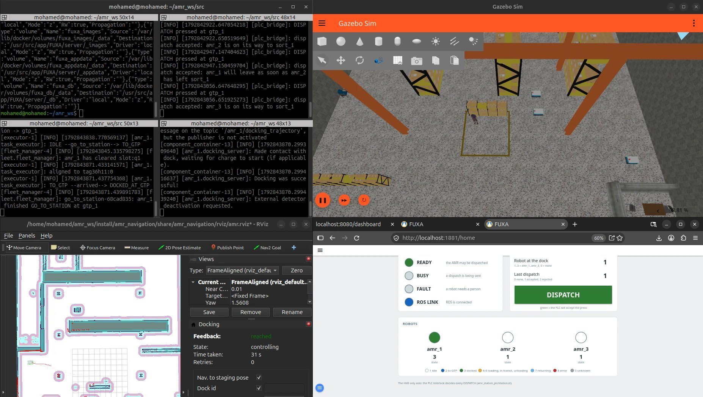
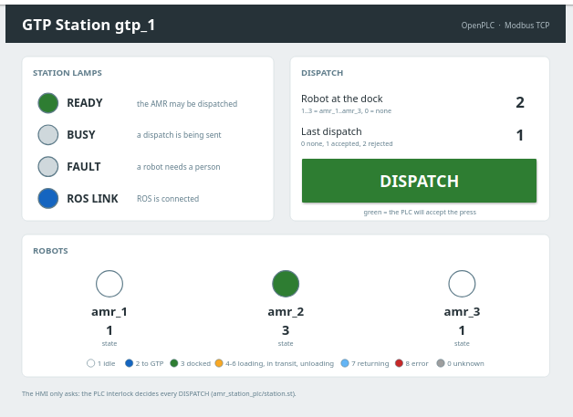
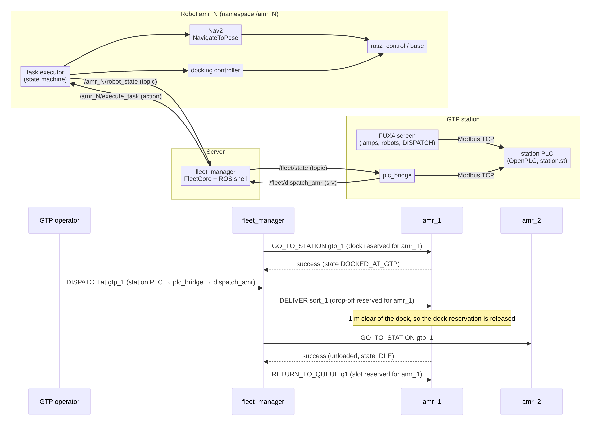

# GTP AMR Fleet: ROS 2, Gazebo, Nav2, PLC and HMI

Three MiR100-style autonomous mobile robots carry picked items from a Goods-to-Person (GTP)
pick station to a sorting area. They run in Gazebo with Nav2, a fleet manager decides who
goes where, and the station is operated like a real line: a PLC program owns the DISPATCH
button and the lamps, and an HMI screen shows the station and the robots.



```
 ready queue ──► GTP dock ──► operator loads ──► DISPATCH ──► drop-off ──► worker unloads ──┐
      ▲                                                                                     │
      └─────────────────────────────────── return ───────────────────────────────────────────┘
```

**What it does**

- **Fleet management.** The fleet manager (ROS 2, Python) reserves every dock, drop-off and
  queue slot, calls the nearest robot to the station, and calls the next one as soon as the
  leaving robot is 1 m clear. Its allocation logic has no ROS import and is unit tested.
- **Navigation and docking.** Each robot runs its own Nav2 under `/amr_N` and parks on a
  floor AprilTag at every place with Nav2's docking server: about 1 cm and under 0.3° on
  the tag, three robots at 99.5 % real time in Gazebo.
- **Industrial control.** The station's PLC program (IEC 61131-3 Structured Text on
  OpenPLC) has an interlock, a request/answer handshake with ROS and a watchdog on the
  ROS link. A FUXA HMI screen talks to it over Modbus TCP, and a ROS 2 bridge connects the
  PLC to the fleet manager. The screen only asks; the PLC decides.
- **Fault handling.** A robot that fails stops, keeps the places it holds, lights the
  station's FAULT lamp, and goes back to work after one reset call.



| Layer | Tools |
|---|---|
| Robots | ROS 2 Lyrical, Nav2 (AMCL, MPPI controller, docking server), apriltag_ros, MiR100 model |
| Simulation | Gazebo Jetty: warehouse world with floor tags, three robots |
| Fleet | Python fleet manager, one ROS 2 action per leg of the cycle, pytest |
| Station | OpenPLC (IEC 61131-3 ST), FUXA HMI, Modbus TCP, pymodbus |
| Tools | colcon, Docker, Git |



Design details, the robot state list, the deadlock rules and the PLC register map are in
[docs/architecture.md](docs/architecture.md).

## Workspace layout

This repository is the `src/` folder of a colcon workspace (for example `~/amr_ws/src`).

| Package | Build type | Runs on | Status | Responsibility |
|---|---|---|---|---|
| `amr_interfaces` | ament_cmake | everywhere | ✅ done | The contract: messages, services and actions shared by all other packages |
| `amr_fleet_manager` | ament_python | fleet server | ✅ done | Task allocation, dock / drop-off / queue reservations, mock AMR for testing |
| `amr_task_executor` | ament_python | each robot | ✅ done | Mission state machine; serves `execute_task` with Nav2's docking server, then turns in place on the floor tag |
| `amr_docking` | ament_python | each robot | ✅ done | Passes the pose of the AprilTag the camera sees to Nav2's docking server |
| `amr_navigation` | ament_cmake (config only) | each robot | ✅ done | Nav2 parameters (AMCL, MPPI inside a rotation shim, docking server), launch file for one robot's Nav2 and tag reader, RViz layout |
| `amr_description` | ament_cmake | each robot | ✅ done | URDF / xacro of the AMR: LiDAR, front camera, Gazebo plugins; `namespace:=` puts its Gazebo topics under `/amr_N` |
| `amr_gazebo` | ament_cmake | simulation | ✅ done | Warehouse world with floor AprilTags, map; launch file that adds one robot with its own ROS ⇄ Gazebo bridge |
| `amr_bringup` | ament_cmake | both | ✅ done | `sim.launch.py`: Gazebo with 1–3 AMRs, each with its Nav2 under `/amr_N`; `fleet.launch.py`: one task executor per robot and the fleet manager (`plc:=true` adds the station PLC bridge) |
| `amr_plc_bridge` | ament_python | GTP station PC | ✅ done | Modbus TCP bridge: writes the station's and robots' state into the station PLC, turns its DISPATCH requests into `/fleet/dispatch_amr` calls |
| `amr_station_plc` | none (files, not a colcon package) | GTP station | ✅ done | `station.st`: the PLC program for OpenPLC (interlock, handshake, watchdog, lamps); `gtp_station_fuxa.json`: the FUXA project with the station screen |
| `amr_hardware_interface` | ament_cmake (C++) | each robot | ⏳ planned | ros2_control diff-drive, battery, e-stop, bin sensors |

Dependency rule: every package may depend on `amr_interfaces`, and no robot-side
package depends on `amr_fleet_manager`. Robots and the fleet manager only talk through
the interfaces below, so either side can be replaced later (for example by Open-RMF).

## Interfaces

| Name | Type | Direction |
|---|---|---|
| `/fleet/dispatch_amr` | `amr_interfaces/srv/DispatchAmr` | station (`plc_bridge`) → fleet manager |
| `/<robot_id>/robot_state` | `amr_interfaces/msg/RobotState` | robot → fleet manager, ≥ 1 Hz (also the heartbeat) |
| `/<robot_id>/execute_task` | `amr_interfaces/action/ExecuteTask` | fleet manager → robot, one goal per leg |
| `/<robot_id>/reset` | `std_srvs/srv/Trigger` | person on the floor → robot, after a failure is cleared |
| `/fleet/state` | `amr_interfaces/msg/FleetState` | fleet manager → station (`plc_bridge`), every tick: who holds each GTP dock, whether DISPATCH would work, every robot's state |

The station PLC's Modbus register map is in [docs/architecture.md](docs/architecture.md#5-the-gtp-station-plc-and-hmi).

## Quick start 1: simulated fleet, no Gazebo needed

Mock robots that only pretend to drive. Tested on ROS 2 Jazzy; the code only uses APIs
available from Humble to Lyrical.

```bash
mkdir -p ~/amr_ws
git clone https://github.com/mm45561/AMR-gtp-fleet.git ~/amr_ws/src
cd ~/amr_ws
rosdep install --from-paths src --ignore-src -y
colcon build --symlink-install
source install/setup.bash
ros2 launch amr_fleet_manager fleet_sim.launch.py
```

The fleet manager waits until all three mock robots have reported (`all 3 robots
reported; work starts`, at most `startup_wait_s` = 10 s), finds them in queue slots
`q1`–`q3` and calls the nearest one, `amr_1`, to `gtp_1`. About 20 s later the log says
`finished GO_TO_STATION at gtp_1`. Then, in a second terminal:

```bash
source ~/amr_ws/install/setup.bash
ros2 topic echo /amr_1/robot_state --field state      # 3 = DOCKED_AT_GTP
ros2 service call /fleet/dispatch_amr amr_interfaces/srv/DispatchAmr "{station_id: gtp_1}"
```

The robot drives to `sort_1`. As soon as it is 1 m clear of the dock, the next robot is
called to replace it. The first one unloads and then returns to a free queue slot.

## Quick start 2: AMRs in Gazebo, full cycle

Tested on Ubuntu 26.04 with ROS 2 Lyrical, Gazebo Jetty, Nav2 and `apriltag_ros`.
Start each step only when the previous one prints the line shown.

| Step | Terminal | Command | Wait for |
|---|---|---|---|
| 1 | 1 | `ros2 launch amr_bringup sim.launch.py` | the map in RViz, then 60 s more |
| 2 | 2 | `ros2 launch amr_bringup fleet.launch.py` | `finished GO_TO_STATION at gtp_1` |
| 3 | 3 | `ros2 service call /fleet/dispatch_amr amr_interfaces/srv/DispatchAmr "{station_id: gtp_1}"` | `finished DELIVER at sort_1` |

Step 1 starts Gazebo and puts `amr_1`, `amr_2` and `amr_3` into queue slots `q1`, `q2`
and `q3`; each robot's Nav2 and tag reader start under its namespace, 5 s apart. RViz
shows `amr_1` (`rviz_robot:=amr_2` shows another one). Step 2 starts the three task
executors and the fleet manager.

The fleet manager waits until every robot has reported (`all 3 robots reported; work
starts`), finds them parked and calls the nearest one to `gtp_1`. After the
dispatch that robot delivers to `sort_1`; as soon as it is 1 m clear of the dock, the
next robot is called to the station. The first one unloads for 4 s and returns to a free
queue slot. To stop, press Ctrl + C in terminal 2, then in terminal 1. A task executor
stopped in the middle of a leg cancels its docking goal first, so the robot stops.

`robots:=1` in steps 1 and 2 runs only `amr_1`, which is lighter on the PC (wait 40 s
after the map instead of 60 s).

Measured in this simulation:

| What | Result |
|---|---|
| Docking | 5 of 5 places in a full cycle, no retries |
| Final position on the tag | about 1 cm, heading under 0.3° |
| AMCL error at `gtp_1` | 2–4 cm |
| One cycle with one AMR (dispatch → back at `gtp_1`) | about 2.5 min |
| Queue slot `q1` → docked at `gtp_1` | about 33 s |
| Three AMRs: Gazebo real-time factor | 99.5 % (RTX 3060) |
| Three AMRs: handoff at `gtp_1` | the next robot is called once the leaving one is 1 m clear |

## Quick start 3: the GTP station (PLC and screen)

The station's DISPATCH button and lamps live in a PLC, as on a real line. The screen
only asks; the PLC decides (interlock, handshake and watchdog are explained in
[docs/architecture.md](docs/architecture.md#5-the-gtp-station-plc-and-hmi)).

```
 FUXA screen ──Modbus──► OpenPLC (station.st) ◄──Modbus── plc_bridge ──► /fleet/dispatch_amr
 lamps, robots ◄───────────── station state ◄──────────────────────────── /fleet/state
```

Tested on Ubuntu 26.04 with Docker, OpenPLC v3 and FUXA 1.3.5.

**One-time setup**

1. Docker and the Modbus library of the bridge, then log out and in again so the
   `docker` group applies:

   ```bash
   sudo apt install -y docker.io docker-buildx python3-pymodbus
   sudo usermod -aG docker $USER
   ```

2. OpenPLC, built from source (a few minutes):

   ```bash
   git clone https://github.com/thiagoralves/OpenPLC_v3.git ~/OpenPLC_v3
   cd ~/OpenPLC_v3 && docker build -t openplc:v3 .
   docker run -d --name openplc --network host --privileged -v openplc_data:/docker_persistent openplc:v3
   ```

3. The PLC program: open http://localhost:8080 (user `openplc`, password `openplc`),
   Programs → Upload Program → `amr_station_plc/station.st`. If the compile page stays
   white, compile the newest upload in the container, then press Stop PLC and Start PLC:

   ```bash
   docker exec -w /workdir/webserver openplc ./scripts/compile_program.sh $(docker exec openplc ls -t /docker_persistent/st_files | head -1)
   ```

   The page shows `Running`. Modbus TCP on port 502 is on by default (Settings).

4. FUXA:

   ```bash
   docker run -d --name fuxa --network host -v fuxa_appdata:/usr/src/app/FUXA/server/_appdata -v fuxa_db:/usr/src/app/FUXA/server/_db -v fuxa_logs:/usr/src/app/FUXA/server/_logs -v fuxa_images:/usr/src/app/FUXA/server/_images frangoteam/fuxa:latest
   ```

   Modbus is a plugin in FUXA: install **Modbus** at http://localhost:1881/plugins. Then
   open http://localhost:1881/editor, click the save icon (top left) → Open Project →
   `amr_station_plc/gtp_station_fuxa.json`. This replaces FUXA's project with the
   OpenPLC device (`127.0.0.1:502`, slave 1), its 10 tags and the station screen.

After a reboot: `docker start openplc fuxa`, then Start PLC on the OpenPLC page (or tick
"Start OpenPLC in RUN mode" in its Settings once).

**Run**

| Step | Terminal | Command | Wait for |
|---|---|---|---|
| 1 | 1 | `ros2 launch amr_bringup sim.launch.py` | the map in RViz, then 60 s more |
| 2 | 2 | `ros2 launch amr_bringup fleet.launch.py plc:=true` | `finished GO_TO_STATION at gtp_1` |
| 3 | browser | http://localhost:1881/home | READY green, DISPATCH button green |
| 4 | browser | click DISPATCH | `DISPATCH pressed at gtp_1`, then `dispatch accepted` in terminal 2 |

`plc:=true` starts `plc_bridge` next to the fleet manager. With Quick start 1 instead of
Gazebo, start the bridge in its own terminal: `ros2 run amr_plc_bridge plc_bridge`.

The screen shows the four lamps of `station.st`, the robot holding the dock, the last
dispatch result and the state of every robot. DISPATCH is green while the PLC would
accept a press.

Checked so far:

| What | Result |
|---|---|
| DISPATCH from the screen, three AMRs in Gazebo | every press with a green button accepted, over several cycles; the next robot is called as in Quick start 2 |
| 3 presses while the button is gray (Quick start 1, the next robot still on its way) | all dropped by the PLC, none reached ROS |
| Fleet manager stopped (Ctrl + C in terminal 2) | ROS LINK goes off within a few seconds and DISPATCH is blocked |

To change the screen, edit it in the FUXA editor, then save icon → Save Project As... and
copy the downloaded file over `amr_station_plc/gtp_station_fuxa.json`.

With `--network host`, the OpenPLC page (8080), FUXA (1881) and Modbus TCP (502) can be
reached from your local network, and Modbus has no password. Change the OpenPLC login,
and on a shared network stop them when you do not need them: `docker stop openplc fuxa`.

## When a robot fails

A robot that cannot finish a leg (blocked path, tag not found, docking cancelled) goes
to `ERROR` and stops. The fleet manager gives it no more work and keeps every place it
holds, so no other robot is sent there. The log says what to do:

```text
amr_1 failed GO_TO_STATION: docking at gtp_1 failed. It keeps ['dock:gtp_1'] and gets
no more work; clear the problem on the floor, then call /amr_1/reset.
```

Clear the problem, then:

```bash
ros2 service call /amr_1/reset std_srvs/srv/Trigger    # answers 'back to IDLE'
```

The fleet manager logs `amr_1 was reset; it gets work again` and puts the robot back in
the queue: a robot standing at a slot is adopted there, any other is sent to the nearest
free slot (a slot it still holds counts as free). Every other place it held is freed once
the robot is `clearance_m` (1 m) away. A reset is refused when the robot is not in
`ERROR` (`nothing to reset`).

To try it in Quick start 2, make the next leg of `amr_1` fail by cancelling its docking
goal. This loop cancels the first docking goal it finds, then stops:

```bash
until ros2 service call /amr_1/dock_robot/_action/cancel_goal action_msgs/srv/CancelGoal "{}" | grep -F "goals_canceling=[a"; do sleep 1; done
```

## Tests

```bash
cd ~/amr_ws
colcon test --packages-select amr_fleet_manager amr_task_executor amr_plc_bridge && colcon test-result --verbose
```

The allocation logic and the PLC register map do not import ROS, so their tests also run
on their own: `cd ~/amr_ws/src/amr_fleet_manager && python3 -m pytest test/test_fleet_core.py`,
`cd ~/amr_ws/src/amr_plc_bridge && python3 -m pytest test/test_plc_map.py`.

## Roadmap

1. `amr_hardware_interface` for a real robot.
