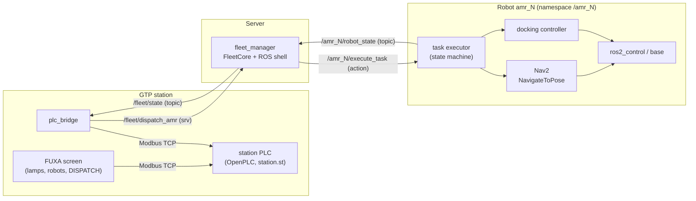
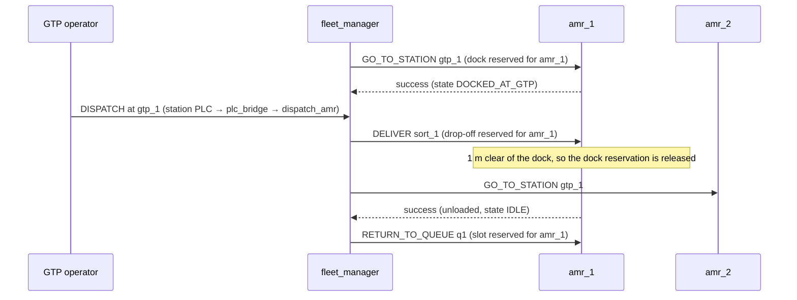

# Architecture

## 1. Who does what

- The **fleet manager** decides *who goes where and when*. It never touches Nav2,
  the map or the motors.
- The **station PLC** decides *whether the robot at the station may leave*: the
  DISPATCH button and the lamps are its I/O, and the screen and ROS only ask (section 5).
- The robot's **task executor** decides *how* to do one leg (undock, plan, drive,
  dock, wait for the operator). `mock_amr` stands in for it in tests without Gazebo.
- One action goal = one leg of the cycle (`GO_TO_STATION`, `DELIVER`,
  `RETURN_TO_QUEUE`). Short goals keep the fleet manager in control between legs,
  so it can choose the return slot at the moment the robot actually needs it.

## 2. The GTP cycle

## 3. Robot states (`RobotState.state`)

| Value | State | Meaning |
|---|---|---|
| 1 | `IDLE` | Parked in a queue slot with no task |
| 2 | `TO_GTP` | Driving to a GTP dock, including the final precision docking |
| 3 | `DOCKED_AT_GTP` | Aligned beside the station, waiting for the operator |
| 4 | `LOADING` | The operator is loading items |
| 5 | `IN_TRANSIT` | Driving loaded to a drop-off |
| 6 | `UNLOADING` | At the drop-off, waiting for the worker |
| 7 | `RETURNING` | Driving empty to a queue slot |
| 0 / 8 | `UNKNOWN` / `ERROR` | Not reported yet / needs a human, who then calls `/<robot_id>/reset` |

`TO_GTP` was added to the requested six states because the robot has to get from the
queue to the station somehow. `UNKNOWN` and `ERROR` make failures visible instead of
silent. *Offline* is not a robot state: the fleet manager decides it when the
heartbeat stops.

## 4. Fleet manager design

**Functional core, thin ROS shell.** `fleet_core.py` has no ROS import. It takes
inputs (`update_robot`, `dispatch`, `on_task_*`, `tick`) and puts the tasks to send
in an outbox. `fleet_manager_node.py` only converts messages and sends goals. All the
allocation logic is tested with plain pytest in about 0.1 s.

**Single-threaded, never blocking.** Everything runs in one executor thread, so there
are no locks. Goals are sent with `send_goal_async()`, and their answers come back as
callbacks. The dispatch service answers immediately: "accepted" means the task was
created, not that the delivery is finished.

**Rules that prevent deadlocks around the station:**

1. *Exclusive reservations.* Every dock, drop-off and queue slot is a resource with
   at most one holder. A robot is only sent somewhere after it holds that place.
   Otherwise its task waits as `PENDING`, for example when a delivery waits for an
   occupied drop-off.
2. *Clearance before release.* A robot keeps the place it is leaving until it is more
   than `clearance_m` away. The next robot is not called into a dock that is still
   being vacated.
3. *Slots ≥ robots.* This is checked at startup. A robot that finishes a delivery
   always has a free slot, so a returning robot can never wait forever.
4. *Fail safe.* An offline or faulted robot keeps every reservation it holds.
   Nobody is sent into a place that it may still be blocking. After the reset
   (`ERROR` → `IDLE`) it is placed like a robot that just reported in, except that
   the places it still holds count as free for it; it keeps each one until it is
   `clearance_m` away.

**Selection policy** (`selection_policy`): `nearest` (straight-line distance to the
dock, ties broken by idle time) or `longest_idle` (spreads wear and battery use evenly).
A better `nearest` would ask Nav2's `ComputePathToPose` for the real path length.

**Restart recovery.** When a robot reports in with no known task, the fleet manager
claims the slot or dock it is standing at (`match_tolerance_m`). An IDLE robot found
anywhere else is sent back to the queue.

**Startup wait.** At start the fleet manager gives out no work until every robot in
`robot_ids` has reported once, or `startup_wait_s` has passed. Otherwise the robot that
happens to report first would be called to the station, even when another is nearer.
A robot that never reports is left out, with a warning.

## 5. The GTP station: PLC and HMI

On a real line the DISPATCH button and the lamps are wired to a PLC, and the decision
"may the robot at the station leave now?" belongs there, not in a screen or a ROS node.
The station works the same way here, with OpenPLC standing in for the hardware PLC:

- `amr_station_plc/station.st` (IEC 61131-3 Structured Text) runs in OpenPLC every
  50 ms. It owns the button, the lamps and the dispatch request.
- The FUXA screen (`amr_station_plc/gtp_station_fuxa.json`) only reads the PLC and, for
  the DISPATCH button, writes 1 to one register. A real push button on `%IX0.0` does the
  same.
- `amr_plc_bridge` is the only part that talks to ROS. Every 0.5 s it writes the
  station's state from `/fleet/state` into the PLC and reads the PLC's dispatch request.

**Three rules in `station.st`:**

1. *Interlock.* A press only becomes a request when an AMR is docked and ready
   (`station_ready = 1`), the ROS link is alive, and no request is pending. One press
   is one request (rising edge), however long the button is held. A press that fails
   these checks is dropped by the PLC and never reaches ROS.
2. *Handshake.* The PLC sets `dispatch_request = 1`. The bridge calls
   `/fleet/dispatch_amr` once, writes the answer to `dispatch_result` (1 accepted,
   2 rejected) and then clears the request. The PLC accepts no new press until then.
3. *Watchdog.* The bridge counts `ros_heartbeat` up only while `/fleet/state` is fresh
   (under 2 s old). If the heartbeat stops changing for 2 s, the PLC drops the link:
   ROS LINK goes off and DISPATCH is blocked. A crashed bridge and a silent fleet
   manager look the same to the PLC, which is the point.

**Register map.** In OpenPLC, memory word `%MWn` is Modbus holding register 1024 + n and
`%QX0.n` is coil n. FUXA numbers Modbus addresses from 1, so its address is one more.

| PLC | Modbus | FUXA | Written by | Meaning |
|---|---|---|---|---|
| `%MW0` | HR 1024 | 1025 | bridge | `ros_heartbeat`, counts 0..999 |
| `%MW1` | HR 1025 | 1026 | bridge | `station_ready`: 1 = an AMR is docked at `gtp_1` and may leave |
| `%MW2` | HR 1026 | 1027 | bridge | `docked_robot`: 1..3 = `amr_1`..`amr_3` holds the dock, 0 = none |
| `%MW3`–`%MW5` | HR 1027–1029 | 1028–1030 | bridge | `RobotState.state` of `amr_1`..`amr_3` |
| `%MW6`–`%MW8` | HR 1030–1032 | 1031–1033 | bridge | robot status: 0 offline, 1 ok, 2 faulted |
| `%MW9` | HR 1033 | 1034 | bridge | `dispatch_result`: 0 none, 1 accepted, 2 rejected |
| `%MW10` | HR 1034 | 1035 | screen | `hmi_button`: the screen writes 1, the PLC reads and clears it |
| `%MW11` | HR 1035 | 1036 | PLC, cleared by the bridge | `dispatch_request` |
| `%IX0.0` | input 0 | 1 | push button | `field_button`, same as `hmi_button` |
| `%QX0.0` | coil 0 | 1 | PLC | `lamp_ready` (green): DISPATCH would be accepted |
| `%QX0.1` | coil 1 | 2 | PLC | `lamp_busy` (yellow): a request is waiting for its answer |
| `%QX0.2` | coil 2 | 3 | PLC | `lamp_fault` (red): a robot is `ERROR` and needs `/amr_N/reset` |
| `%QX0.3` | coil 3 | 4 | PLC | `lamp_link` (blue): the watchdog sees the heartbeat |

The bridge's side of this table is `amr_plc_bridge/plc_map.py`, which has no ROS import
and is tested with plain pytest.

## 6. ROS 2 distribution

| Distro | End of life | Verdict for a new project in late 2026 |
|---|---|---|
| Iron | Dec 2024 | Already end of life, do not use |
| Humble | May 2027 | Only if a hardware vendor forces it |
| **Jazzy** | May 2029 | Recommended for the robots |
| Lyrical | May 2031 | Fine (newest LTS, on Ubuntu 26.04) |

The fleet manager and the mock robots are tested on Jazzy and avoid APIs newer than
Humble. The Gazebo simulation runs on Lyrical: the robots park with Nav2's docking
server (`opennav_docking`, Jazzy and later), which `amr_docking` feeds with the floor
tag's pose.

## 7. Scaling from 3 to 10+ robots

- **Namespaces everywhere.** Each robot runs its full stack under `/amr_N`, including
  Nav2 with `/tf` → `tf` remapping, so robots never see each other's transforms. The
  simulation already works this way: its Gazebo topics, bridge, Nav2, tag reader and
  task executor all live under `/amr_N` (`amr_bringup sim.launch.py`).
- **Discovery across machines.** `ROS_AUTOMATIC_DISCOVERY_RANGE=LOCALHOST` is fine on
  one laptop but blocks a real fleet. Use `SUBNET` with a shared `ROS_DOMAIN_ID`.
  Past about 5 robots on Wi-Fi, switch to a Fast DDS discovery server or `rmw_zenoh`.
- **Traffic zones.** The reservation table already supports any named zone. Next,
  add the aisle in front of the GTP dock as a zone that a robot must hold to enter.
- **Open-RMF.** Once the fleet needs lifts, doors, mixed vendors or real path-level
  traffic negotiation, write an Open-RMF fleet adapter around the robots' `execute_task`
  instead of growing this fleet manager.

## 8. Known gaps (next steps)

- If a robot reboots in the middle of a task, its goal is lost. Compare
  `RobotState.task_id` with the active task, and fail the task when they disagree for
  longer than the heartbeat timeout.
- No charging task: robots below `min_battery_percent` simply get no new work.
- Queue slots must be side-by-side bays. A single-file lane would need "move up"
  tasks.
- The task executor does not stop cleanly in the middle of a leg: `_wait()` waits for
  the docking result without a timeout, so Ctrl + C leaves the process hanging until
  `launch` kills it, and the Nav2 docking goal keeps the robot driving. On shutdown it
  should cancel the goal and give up the wait.
- The station PLC has registers for one station and three robots (`PLC_ROBOTS`).
- OpenPLC's web page, FUXA and Modbus TCP have no real security here (default OpenPLC
  login, Modbus has no authentication). Keep them on a closed network.
